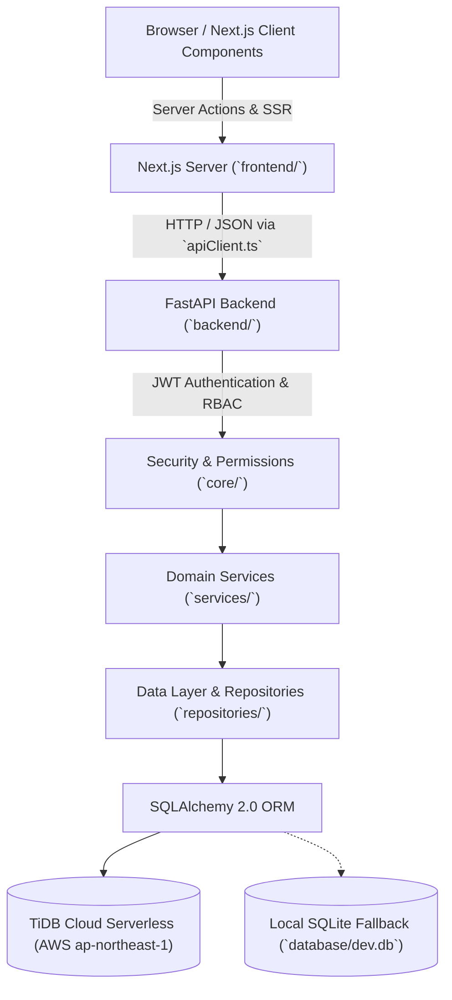
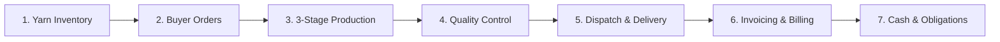

# TEXFLOW — System Architecture & Design Specification

## 1. Executive Architecture Summary

**TexFlow** is a modern, unified operations platform designed for Everest Textile Mills. It replaces paper slips, registers, and informal messaging with a real-time, ledger-backed textile manufacturing platform.

The system is organized into a clean, decoupled two-tier architecture:
1. **Frontend (`frontend/`)**: Next.js 16 (App Router, Turbopack, Tailwind CSS, TypeScript) with the Stitch industrial UI design system.
2. **Backend (`backend/`)**: Python 3.12, FastAPI, SQLAlchemy 2.0 ORM, Alembic migrations, and Pydantic validation.
3. **Database (`database/`)**: Primary distributed cloud database on **TiDB Cloud** (`gateway01.ap-northeast-1.prod.aws.tidbcloud.com:4000/texflow`) with local SQLite fallback (`database/dev.db`), managed via dialect-agnostic SQLAlchemy 2.0 models.



---

## 2. Directory Structure

```text
texflow/
├── frontend/                     # Next.js 16 Web Application
│   ├── src/
│   │   ├── app/                  # App Router pages, layouts, and server actions
│   │   ├── components/           # UI components (Navbar, Sidebar, Modals, Tables)
│   │   ├── hooks/                # Client hooks
│   │   ├── lib/                  # Reusable libraries (api-client.ts, auth.ts, tokens.ts)
│   │   └── types/                # TypeScript interfaces and domain types
│   ├── public/                   # Static assets, logos, and icons
│   ├── package.json              # Frontend dependencies and npm scripts
│   ├── next.config.ts            # Next.js Turbopack configuration
│   └── tsconfig.json             # TypeScript configuration (@/* path alias)
│
├── backend/                      # Python FastAPI Application
│   ├── app/
│   │   ├── main.py               # Application factory, middleware, router mount
│   │   ├── core/                 # Config, security (bcrypt + JWT), auth dependencies
│   │   ├── db/                   # SQLAlchemy engine, sessionmaker, declarative base
│   │   ├── models/               # SQLAlchemy 2.0 entity models
│   │   ├── schemas/              # Pydantic v2 validation schemas
│   │   ├── api/routes/           # HTTP endpoints organized by functional domain
│   │   ├── services/             # Domain business logic & transactions (BR-01..BR-26)
│   │   └── repositories/         # Database access layer
│   ├── alembic/                  # Alembic migration environment and versions
│   ├── tests/                    # Pytest test suite (unit and API integration tests)
│   ├── requirements.txt          # Python pip dependencies
│   ├── alembic.ini               # Alembic configuration
│   └── .env.example              # Environment variable template
│
├── database/                     # Database files and migration documentation
│   ├── dev.db                    # Primary SQLite database
│   ├── dev.db.bak                # Database snapshot backup
│   ├── README.md                 # Schema ownership and recovery guide
│   └── migrations/               # Migration records and documentation
│
├── docs/                         # Architecture and technical documentation
│   └── architecture.md           # This document
│
├── scripts/                      # Seed scripts and test runners
├── .gitignore                    # Git exclusions
├── .env.example                  # Root environment variable template
├── README.md                     # Project installation and run instructions
├── TASKS.md                      # Milestone task tracking and verification log
└── AGENTS.md                     # Agent rules and conventions
```

---

## 3. Core Business Workflow & Data Pipeline

The mill operations flow continuously through the following stages:



1. **Yarn Inventory**: Gate receipts, lot allocations, ledger movements, and stock health thresholds (Healthy, Low, Critical, Out of Stock).
2. **Buyer Orders**: Requirement calculation (1.05 waste allowance), automated FIFO lot reservation, and Manager review workflow.
3. **Production Pipeline**: Sequential Work Orders (Knitting &rarr; Dyeing &rarr; Finishing) with 95%–105% output tolerance enforcement, machine assignments, and breakdown reassignments.
4. **Quality Control**: Fabric roll inspection with 4-point defect grading (`PASSED`, `REJECTED`, `QUARANTINED`, `PENDING_REVIEW`).
5. **Dispatch**: Store management where only `PASSED` rolls in store are dispatch-eligible.
6. **Invoicing & Payments**: Auto-generation of matching invoice upon dispatch; payment recording with balance tracking.
7. **Finance & Costing**: Attendance tracking, monthly wages calculation, and real-time cash flow analysis separated from unpaid obligations.

---

## 4. Security & Role-Based Access Control (RBAC)

Authentication is secured via:
- **Password Hashing**: Industry-standard `bcrypt` password verification.
- **Tokens**: HS256 JWT access tokens transmitted via standard HTTP Authorization Bearer headers or HTTP-only cookies (`texflow_session`).
- **Role Permissions**:
  - `ADMINISTRATOR`: Full system access across all manufacturing and financial operations.
  - `MANAGER`: Order reviews, inventory management, dispatch approvals, invoices, and supplier bills.
  - `FLOOR`: Production machine logging, stage completion, defect logging, and roll inspection.
  - `BUYER`: Data-isolated Buyer Portal access for personal orders, deliveries, and invoices.
